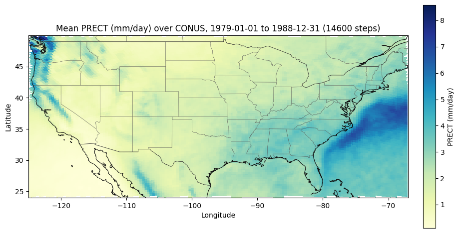

# Using the uxarray MCP server on Casper: a 10-year CONUS precipitation map from 37 GB that never moved

## The prompt

This is the entire input. Typed into an AI assistant on a laptop. No script, no
file list built by hand, no cluster commands, no coordinates.

> I've got a Globus Compute endpoint running on Casper at NCAR — it's called
> `ucar-uxarray-yac`. All the data is on the NCAR filesystem. Nothing is on my
> laptop, and I don't want to download any of it.
>
> Here's what I have:
>
> **Mesh** (CESM ne120 spectral element, about a quarter degree):
> `/glade/p/cesmdata/cseg/inputdata/share/scripgrids/ne120np4_pentagons_100310.nc`
>
> **Data** — 6-hourly PRECT, one file per year, 1979 through 1988, under
> `/gdex/data/d651007/b.e13.BHISTC5.ne120_t12.cesm-ihesp-hires1.0.30-1920-2005.002/atm/proc/tseries/hour_6/`,
> named `...cam.h2.PRECT.1979010100-1980010100.nc` through
> `...cam.h2.PRECT.1988010100-1989010100.nc`.
>
> Can you give me a ten-year average precipitation map over the continental US?
> PRECT comes out in m/s and I'd like it in mm/day. Run everything on Casper —
> don't pull the files over. When you're done, tell me exactly what ran where,
> so I can put it in a methods section.

## The output

Measured on 2026-09-11 against `ucar-uxarray-yac`, printed here in the layout
the current reproduction script uses:

```
ELAPSED           462.1 s
n_files           10
n_time_steps      14600
time span         1979-01-01 00:00  →  1988-12-31 18:00
n_faces_in_region 23510  of 777602   (3.02% of the mesh)
value_stats       min 0.111   mean 2.232   max 8.584 mm/day
venue             hpc:ucar-uxarray-yac
worker            casper02
provenance.tool   plot
provenance.op_id  op_1676bc621555
```



*Mean PRECT, 1979–1988, CESM ne120 spectral-element mesh, subset to CONUS.
14,600 six-hourly time steps. 23,510 of 777,602 mesh cells. Computed on
casper02 at NSF NCAR. Rendered by the previous server version, which drew
Natural Earth coastlines and borders; the current `plot(kind="temporal_mean")`
draws no coastlines, so a rerun gives the same field without the overlay.*

> **Read the mean correctly.** 2.232 mm/day is the average over the whole
> bounding box, which includes ocean — the deep blue offshore of the Carolinas
> is the Gulf Stream, not land. This is a box average, not a land-masked CONUS
> average.

## Why this matters

One paragraph of plain English produced a publication-shaped map from ten years
of 6-hourly CESM output living on the NCAR filesystem — plus a machine-readable
record of exactly which function ran, on which host, under which PBS job, over
how many time steps. No data was downloaded. The laptop never held more than a
178 KB PNG.

If you work with climate model output at NCAR, the shape of the problem is
familiar: the data lives on GLADE or GDEX, your analysis code lives on your
laptop, and bridging the two costs an afternoon of logistics, not science.
Three things make this different from "an AI wrote some code for me":

1. **The compute went to the data.** The ~37 GB of 6-hourly output stayed on the
   NCAR filesystem. A small function was shipped *to* Casper, ran there, and
   sent back a picture. This is the only pattern that scales.
2. **Nothing was invented.** The assistant did not write a script and hope. It
   called specific, tested functions in a server that already knows how to open
   an unstructured mesh, subset it, and reduce it.
3. **The answer is auditable.** Every call returned a provenance record. You can
   put `hpc:ucar-uxarray-yac`, `casper02`, 14,600 time steps and 23,510 of
   777,602 cells into a methods section and someone else can check it. A
   picture alone cannot tell you what was averaged away. This record can.

That third point is the one worth arguing about. AI assistants are good at
producing plausible plots; the engineering question is how you know a plot is
*right*. The answer here is not "trust the model" — it is that the model can
only call a fixed set of instrumented functions, and each one reports what it did.

**MCP** — Model Context Protocol — is what makes that fixed set: a small
program, the **server**, publishes a menu of tools and the assistant can call
nothing else. The server can be tested like any software, and because it, not
the model, produces the result, it can attach a provenance record the model
cannot forge. The **uxarray MCP server** publishes twelve operations over
unstructured climate meshes (MPAS, CESM spectral-element, SCRIP, UGRID,
HEALPix) and runs them on your laptop or, via
[Globus Compute](https://www.globus.org/compute), on an HPC endpoint next to
the data.

## What the assistant did with the prompt

It translated the paragraph into one tool call:

```python
plot(
    kind="temporal_mean",
    grid_path="/glade/p/cesmdata/cseg/inputdata/share/scripgrids/ne120np4_pentagons_100310.nc",
    data_paths=[...ten annual PRECT files...],
    variable_name="PRECT",
    lon_bounds=[-125, -67],           # CONUS
    lat_bounds=[24, 50],
    scale_factor=86400000.0,          # m/s -> mm/day
    units_label="mm/day",
    title="CONUS",
    cmap="YlGnBu",
    width=1000, height=560,
    use_remote=True,
    endpoint="ucar-uxarray-yac",
)
```

Three inferences it had to make, none of them stated in the prompt:

| you said | it chose | why that is right |
|---|---|---|
| "continental US" | `lon_bounds=[-125,-67]`, `lat_bounds=[24,50]` | and crucially **negative** longitudes — uxarray normalizes to −180..180, so the naive `[235, 293]` selects nothing at all |
| "m/s, I'd like mm/day" | `scale_factor=86400000.0` | 86,400 s/day × 1000 mm/m |
| "run everything on Casper" | `use_remote=True`, `endpoint="ucar-uxarray-yac"` | the alternative — streaming 37 GB to a laptop — is not a thing that finishes |

## Reading the result

**The map**, read as a scientist would: dry Great Basin and Desert Southwest;
wet Pacific Northwest and a clean Sierra Nevada crest; wet Gulf Coast and
Southeast with a visible Appalachian ridge signal; maximum offshore over the
Gulf Stream. That the features land where the geography says they should is
itself the test. A longitude-convention bug would have put the Sierra in Kansas.

**The paperwork.** `plot` returns two content blocks: the image (inline base64
when under 256 kB, otherwise a `resource_link` to the stored PNG) and a JSON
text block. The JSON carries `_provenance`, the part you can cite:

```json
"_provenance": {
  "tool": "plot",
  "venue": "hpc:ucar-uxarray-yac",
  "inputs": {"kind": "temporal_mean", "grid_path": "<grid path>", "variable_name": "PRECT",
             "lon_bounds": [-125.0, -67.0], "lat_bounds": [24.0, 50.0], ...},
  "remote": {"hostname": "casper02", "operation_id": "op_1676bc621555",
             "python_version": "...", "uxarray_version": "...",
             "elapsed_seconds": ..., "worker_elapsed_seconds": ..., "job_id": "..."}
}
```

And alongside it, the reduction record — what was averaged away:

```json
"n_files": 10, "n_time_steps": 14600,
"time_min": "1979-01-01T00:00:00", "time_max": "1988-12-31T18:00:00",
"reduced_dims": {"time": {"kind": "time", "how": "mean", "size": 14600}},
"n_faces_total": 777602, "n_faces_in_region": 23510, "render_mode": "polygons",
"value_stats": {"min": 0.111, "mean": 2.232, "max": 8.584}
```

**This is the point of the whole exercise.** A PNG cannot tell you whether it
averaged 14,600 time steps or accidentally took one, whether your bounding box
selected 23,510 cells or zero, or whether a level index was silently taken. The
JSON says all three, in the same response, so a wrong plot is *falsifiable*
rather than merely pretty.

## How it worked under the hood

1. **The assistant picks one tool and fills in arguments**: `plot` with
   `kind="temporal_mean"`.
2. **The server routes it.** `use_remote=True` plus `endpoint=` forces the
   Casper endpoint; without them, a path starting `/gdex/` is matched against
   each endpoint's configured `path_prefixes`.
3. **The function is serialized and shipped.** Globus Compute's
   `AllCodeStrategies` sends the source of one small shim, `run_op`, which on
   the worker imports `uxarray_mcp.core.ops` and calls the named operation.
4. **A Casper worker runs it**, inside the NCAR filesystem boundary:

   | # | stage | what it does |
   |---|---|---|
   | 1 | open | `xr.open_mfdataset` over the ten annual files; the SCRIP mesh via uxarray |
   | 2 | reduce | mean over 14,600 time steps, then `× 86,400,000` for m/s → mm/day |
   | 3 | subset | `subset.bounding_box([-125,-67], [24,50])` on the mean field, cutting 777,602 cells to 23,510 |
   | 4 | render | uxarray `polygons()` on the matplotlib backend; meshes above 200,000 faces are rasterized instead, and `render_mode` says which |
   | 5 | package | `min` / `mean` / `max`, `n_faces_in_region`, `time_min` / `time_max`, and the remote provenance block |

5. **A PNG and a JSON record come back.** ~180 KB total, in one response. If
   the call outlives the endpoint timeout the tool returns
   `{"status": "running", "operation_id": ...}` instead, and
   `get_operation(operation_id=..., wait_seconds=...)` collects the result.

That is one tool call, not a pipeline you assembled. The server publishes
twelve tools in total; [`docs/tools.md`](../../docs/tools.md) is the menu with
the result contract and [`docs/architecture.md`](../../docs/architecture.md)
explains how a tool dispatches to the operation in `core/`.

**Subset order.** The version that produced the figure subset the mesh
*before* the time mean, so only 23,510 cells were carried through the
reduction. The current `_plot_temporal_mean` takes the time mean first (lazily,
through `open_mfdataset`) and crops after. The bytes read are the same either
way — see the next section — but the 462 s figure was measured with the
subset-first ordering and the current ordering has not been timed here.

**Guardrails you can see working.** A box that selects zero faces fails on the
worker instead of returning a blank figure, and the `subset` tool's refusal
names the mesh's extent so the −180 / 0..360 mix-up is visible. Remote
failures come back as one typed `error_code` (`ENDPOINT_OFFLINE`, `NO_WORKER`,
`WORKER_LOST`, `FILE_NOT_FOUND_ON_WORKER`, `WORKER_MISSING_PACKAGE`), each
mapped to a fix in [`docs/hpc.md`](../../docs/hpc.md). If the worker's
`uxarray` or `uxarray-mcp` differs from yours, the result carries a warning.

## Why it takes 462 seconds

Worth being blunt about, because 7.7 minutes feels slow for what looks like one
average. **It is I/O bound. The arithmetic is nothing; the reading is
everything.**

PRECT is stored as `(time, ncol)` float32. Per year that is
1460 × 777,602 × 4 B = **4.54 GB**. Ten years is **45.4 GB decompressed**, about
37.5 GB on disk. At 462.1 s that is roughly **81 MB/s off disk, 98 MB/s
decompressed** — a single-stream rate. Three reasons, in order of size:

1. **The CONUS subset saves no reading at all.** You keep 3.02% of cells, but
   those 23,510 indices are scattered through `ncol`, and netCDF chunks are read
   whole. You read essentially all 45 GB to keep 1.4 GB. Subsetting saves memory
   and arithmetic — not I/O.
2. **One worker, one stream.** The ten annual files are read sequentially. They
   are completely independent, so this is the obvious 5–10× win available.
3. **Workers run on the login node.** The endpoint uses `LocalProvider` (see
   the Casper section of [`docs/hpc.md`](../../docs/hpc.md)). Login-node I/O is
   shared and throttled; compute nodes read faster.

**The per-year cost is not constant, and the gap is worth naming.** One year
takes 29.1 s; ten take 464.4 s. That is 16× the wall clock for 10× the data —
about 29 s for the first year against roughly 48 s for every year after it; a
straight line through the two points has a *negative* intercept, which is not
what fixed per-call overhead looks like, and throughput agrees (129 MB/s on the
single-year read, 81 MB/s across ten). The likely explanation is the page
cache: the 1979 file was read again and again while this case study was being
built, so its 29 s is a warm number and the ten-year figure is closer to the
cold cost. That is a suspicion, not a measurement — nothing here dropped the
cache between runs. Plan with **~48 s per year**; treat 29 s as what you get on
a file the filesystem already holds in memory.

**If you need it faster:** compute the ten annual means once and average those —
the repeat becomes seconds. Or parallelize the file reads. Or move the provider
off the login node.

## What it cost

**Wall clock**, measured against `ucar-uxarray-yac` (casper02) on 2026-09-11
with the previous server version:

| what | time |
|---|---|
| mesh inspection (topology; now `inspect_dataset`) | ~20 s |
| **1 year**, direct call to the compute function | 29.1 s |
| **1 year**, full chain through the MCP server | 51.4 s / 77.5 s (two runs) |
| **10 years**, direct call | 464.4 s |
| **10 years**, full chain through the MCP server | 462.1 s |
| cold-worker penalty if no worker is allocated | add 1–4 min (PBS queue) |

The MCP layer costs approximately nothing: 462.1 s through the full chain versus
464.4 s calling the compute function directly, with identical values to every
printed digit.

**Bytes.** Laptop → Casper: a serialized function plus arguments, a few KB.
Casper → laptop: a 177,737-byte PNG plus ~3 KB of JSON. What never moved: ~37 GB
of 6-hourly CAM output. Roughly **200,000:1**, which is the entire argument for
moving compute to data rather than data to compute.

**Tokens.**

| item | approximate tokens |
|---|---|
| **standing cost:** the tool menu, sent on *every* request — 33 tools in the version measured | **~10,600** |
| the paragraph you typed | ~200 |
| the returned map (1000×560 image) | ~750 |
| the returned metadata + provenance JSON | ~750 |

**The standing cost dominates.** The version measured published 33 tools, so
~10.6k tokens of schema rode along with every message whether or not you used
any of them (counted with `tiktoken`, `cl100k_base`, over the registered tool
list). Nearly half of that was tool *descriptions*. This was a real argument
for a narrower tool list, and the rebuild acted on it: the server now registers
twelve tools with short docstrings. The new standing cost has not been
re-measured for this case study. Either way, turn the server off in sessions
not doing mesh analysis; most MCP clients let you enable servers per session.

## Set it up yourself

[`docs/hpc.md`](../../docs/hpc.md) is the full reference (prerequisites,
endpoint scripts, registration, troubleshooting); its Casper section has the
exact commands. The parts specific to this case study:

```bash
# laptop
uv tool install --python 3.12 --extra hpc uxarray-mcp
claude mcp add uxarray --transport stdio -- uxarray-mcp serve

# Casper: worker env (Python 3.12; uxarray_mcp.core must be importable, the shim imports it)
module load conda
conda create -p /glade/work/$USER/conda-envs/uxarray_312 python=3.12 -c conda-forge -y
conda activate /glade/work/$USER/conda-envs/uxarray_312
pip install "uxarray[geo,viz]" netCDF4 h5netcdf globus-compute-endpoint
pip install --no-deps uxarray-mcp
ENDPOINT_NAME=ucar-uxarray ./scripts/ucar_endpoint.sh configure && ENDPOINT_NAME=ucar-uxarray ./scripts/ucar_endpoint.sh start

# laptop: register with EVERY prefix you will read from, then probe
uxarray-mcp endpoints add ucar-uxarray-yac <uuid> --path-prefix /glade/ --path-prefix /gdex/
uxarray-mcp doctor --endpoint ucar-uxarray-yac
```

- `[geo,viz]` is required: a bare `uxarray` imports fine and fails mid-render.
- The profile used here was named `ucar-uxarray-yac` because it also carried a
  YAC build; the script refuses a `*yac*` name unless `WITH_YAC=1`, and this
  analysis needs no YAC. The local alias need not match the profile name.
- Without `/gdex/`, a GDEX path matches no endpoint and falls through to your
  default — possibly a cluster at another facility that cannot see the file.
  That mistake was made while building this case study.
- The default `timeout_seconds` is 1800, which covers the 462 s ten-year run.
  Longer calls return `status: running`; collect them with `get_operation`.
- `endpoint(action="status", endpoint="ucar-uxarray-yac")` reports manager
  state plus a worker probe; `registered` without a worker means the next real
  call waits in the PBS queue.

Then paste [The prompt](#the-prompt) with your own endpoint name and paths.
Start with one year before you ask for ten.

## Methods: what was used

**Software, as run on 2026-09-11**

| component | version / detail |
|---|---|
| uxarray MCP server | v2026.9.0 (previous tool surface) |
| submitter Python | 3.12.10 (laptop) |
| worker Python | 3.11.12 (Casper conda env at the time; the current worker env is 3.12). The minor-version skew warned (`Environment differences detected...`) and worked here; `docs/hpc.md` and [globus/globus-compute#2139](https://github.com/globus/globus-compute/issues/2139) say why not to rely on it |
| serialization | Globus Compute `AllCodeStrategies`, Dill 0.3.9 both ends |
| geography | cartopy 0.24.1 on the worker drew the coastlines in the figure; the current `plot(kind="temporal_mean")` draws none |

**The call chain, current version**

```
plot(kind="temporal_mean", ...)                    # server/tools.py
  └─ _run("plot_temporal_mean", ...)               # local or remote routing
       └─ executor.submit(shim.run_op, ...)        # remote/executor.py, Globus Compute
            └─ ops.call("plot_temporal_mean")      # core/ops.py::_plot_temporal_mean
                                                   #   ↑ runs on the Casper worker
```

The run that produced the figure used the previous version's
`plot_dataset(plot_type="temporal_mean")` and a worker function written for
this case study. The current `_plot_temporal_mean` in `core/ops.py` does the
same open / mean / scale / crop / render, minus the coastline overlay, and is
the same function whether it runs locally or on the worker. The endpoint was
registered with `path_prefixes: [/glade/, /gdex/]` and `timeout_seconds: 2400`.

**Two bugs found and fixed while producing this** (in the version used): the
whole-mesh plot type accepted `lon_bounds`/`lat_bounds` and silently ignored
them, returning a global map; it was changed to raise. In the current server
the bounds crop for `kind="temporal_mean"` and `kind="mesh"`; check
`_provenance.inputs` and `n_faces_in_region` rather than assuming a box was
applied. And `path_prefixes` listed only `/glade/`, so GDEX paths routed to the
default endpoint at a different facility.

**Measured versus estimated.** Wall-clock times, byte counts, cell counts and
all `value_stats` are measured from the runs described, with the previous
server version. The tool-schema token figure is measured from that version's
registered tool list; image and JSON token figures are standard approximations.

## Reproducing it

Every number above is produced by a script in this repository:

```bash
uv run python case-studies/conus-precipitation-gdex/scripts/reproduce_conus_case_study.py --act 1   # inspect_dataset, ~3-20 s
uv run python case-studies/conus-precipitation-gdex/scripts/reproduce_conus_case_study.py --act 2   # 1-year mean, ~30 s
uv run python case-studies/conus-precipitation-gdex/scripts/reproduce_conus_case_study.py --act 3   # 10-year mean, ~7.8 min
uv run python case-studies/conus-precipitation-gdex/scripts/reproduce_conus_case_study.py --all
```

It calls `tools.inspect_dataset`, `tools.plot` and, when a call outlives the
endpoint timeout, `tools.get_operation`, and asserts the published values so a
drift in the data, the mesh, or the reduction fails the run instead of quietly
producing a different map. It needs the endpoint from
[Set it up yourself](#set-it-up-yourself). The script has been ported to the
rebuilt tool surface but not yet rerun against it; the table below is from the
previous version.

### What a rerun actually showed

Run on 2026-09-11/12 against `ucar-uxarray-yac`, previous server version:

| quantity | published | rerun |
|---|---|---|
| faces / nodes / edges | 777,602 / 780,456 / 2,329,471 | identical |
| time steps in the 10-year mean | 14,600 | 14,600 |
| CONUS subset | 23,510 of 777,602 | 23,510 of 777,602 |
| min / mean / max mm/day | 0.111 / 2.232 / 8.584 | 0.110901 / 2.232262 / 8.584175 |
| non-finite values (reported by that version) | 0 | 0 |
| PNG size | 177,737 B | 177,737 B, `cmp` byte-identical |
| wall clock, 10 years | 462.1 s | 467.9 s |

> [!IMPORTANT]
> Read that table for what it is. The rerun carries the same PBS job ID,
> `5890924.casper-pbs`, as the original — same worker process, same node, same
> library versions, very likely the same page cache. A byte-identical PNG under
> those conditions shows the pipeline is **deterministic**, not that it
> reproduces across a fresh allocation, another node or another matplotlib
> build; the byte match would be the first thing to break, and it will
> certainly differ under the current renderer, which draws no coastlines. The
> scientific values — cell counts, step counts, statistics — are the durable part.

## Honest limitations

- **Ten years takes 7.7 minutes.** That is real work on real data and there is
  no trick that makes it instant. Plan for it; run one year first.
- **The mean is over a box, not over land.** 2.232 mm/day includes the offshore
  Atlantic and Pacific inside the bounding box. A land-masked CONUS average is a
  different number.
- **No coastlines on a remote temporal mean.** The current `plot` draws Natural
  Earth features only for `kind="mesh"`, and only locally. The field is the
  same; the overlay in the figure above is from the previous version.
- **The endpoint has to be up, and cold start hurts.** A down manager is
  `ENDPOINT_OFFLINE` (`./scripts/ucar_endpoint.sh restart` on Casper); the
  first call after an idle period waits in the PBS queue.
- **The worker must have `uxarray-mcp` installed.** Only a small shim is
  shipped with each call; the science runs from `uxarray_mcp.core` on the
  worker, so a fix released on your laptop is absent on Casper until the worker
  env is updated and the endpoint restarted (`scripts/ucar_update.sh --restart`).
- **The ensemble member.** This case study uses member `.002`; the originating
  request named member #10, but only `.002` and `.003` are staged in the
  6-hourly tier of `d651007`. Which member you get is a property of what is on
  disk, and the provenance record is what makes that checkable.
- **The assistant can still be wrong about what you meant.** It inferred a CONUS
  bounding box you did not specify. That inference was right, and it is recorded
  in `_provenance.inputs` so you can check it.

## Reference

- Dataset: UCAR GDEX `d651007` (MESACLIP), CESM iHESP high-resolution historical
- Mesh: `ne120np4_pentagons_100310.nc` — CESM ne120 spectral element, SCRIP
  format. The grid file presents GLL nodes as face centers, a quirk of how SE
  grids are written to SCRIP; uxarray reads 777,602 "faces" and everything
  downstream stays consistent.
- Variable: `PRECT`, total precipitation rate, m/s
- Docs: [`docs/hpc.md`](../../docs/hpc.md) (endpoints, Casper, provenance,
  troubleshooting) · [`docs/tools.md`](../../docs/tools.md) (tool menu and
  result contract) · [`docs/architecture.md`](../../docs/architecture.md)
